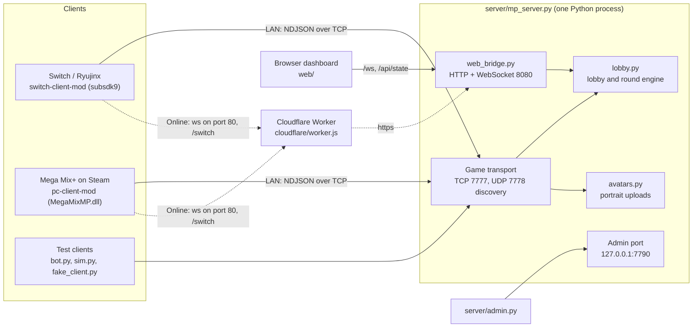

# Project DIVA Mega Mix Multiplayer Mod

> [!NOTE]
> Work in progress. Open bugs and unverified areas are listed in
> [Contributing & Troubleshooting](#contributing--troubleshooting).

## Overview

This project lets people play *Hatsune Miku: Project DIVA Mega Mix* together. Players join a
room; the room's leader picks a song, every other game mirrors the pick, all games launch
together and wait until everyone has loaded, then play with a live leaderboard, see the final
standings and return to song select.

It is for players on a modded Nintendo Switch, on the Ryujinx emulator or on the Steam release
(Mega Mix+), and for whoever hosts the room server on a PC or online. A browser dashboard lets
anyone on the network spectate and lets a room's host manage it.

Key architectural choices:

- **In-process game mods, server-side rooms.** Each client is a mod loaded into the game. All
  lobby and round logic lives in one pure, unit-tested Python module (`server/lobby.py`).
- **One protocol, two transports.** Clients speak newline-delimited JSON (protocol v1, specified
  in the `server/lobby.py` docstring) over raw TCP with UDP discovery on a LAN, or over a
  WebSocket on `/switch` when the server is online behind a single port.
- **No server dependencies.** The server uses the Python standard library only. Rooms live in
  memory; there is no database.
- **No TLS on the Switch.** Consoles connect with plain-HTTP WebSocket; a Cloudflare Worker
  forwards `/switch` to the HTTPS-only host.
- **Exact game builds.** Hook offsets are hard-coded. No runtime version check was found in
  either client, so use the builds below.

| Client | Game build the offsets target |
| --- | --- |
| Switch / Ryujinx | Mega Mix (EN), title ID `01001CC00FA1A000`, update 1.0.6 (v393216), main build ID `179265bd41f7781dac979e77702011241b442ba1` |
| PC | Mega Mix+ 1.03 (Steam build 11004484), loaded by DivaModLoader |

The Switch client is a fork of [lsmsmx's MikuMikuSwitchPlugin](https://github.com/lsmsmx/MikuMikuSwitchPlugin)
(exlaunch). Its non-multiplayer features (mod loader, New Classics, debug mode, freecam,
overlays) are documented in [`switch-client-mod/README.md`](switch-client-mod/README.md).

## Architecture & Directory Layout



| Path | What lives there |
| --- | --- |
| `switch-client-mod/` | Switch mod (C++, exlaunch). Builds `deploy/subsdk9` + `deploy/main.npdm`. Multiplayer code is in `source/program/mp/` (`MpNet` networking thread, `MpLobby` phase machine, `MpInput` input injection/blocking, `MpMenu`, `MpUi`/`MpOverlay`, `MpAvatar`, `MpModuleDb`). `source/program/nc/` is New Classics; `source/lib/` is the exlaunch framework. |
| `pc-client-mod/` | PC port of the multiplayer client (C++23, MSVC), a DivaModLoader mod. `src/mp/` mirrors the Switch files; `src/game/` holds the MM+ hooks and addresses; `src/platform/` the Windows shims; `third_party/` vendored safetyhook, Dear ImGui, toml++ (see `third_party/README.md`). |
| `server/` | `mp_server.py` (transports, discovery, admin port), `lobby.py` (engine), `web_bridge.py` (HTTP/WebSocket), `avatars.py`, `netcheck.py` (LAN address and Windows Firewall check), `admin.py` (admin/debug CLI), `bot.py` / `sim.py` / `fake_client.py` (test clients), `test_*.py`. |
| `web/` | Dashboard: React 19 + Vite + TypeScript. Built output `web/dist` is served by the server. |
| `cloudflare/` | Worker (`worker.js`, `wrangler.toml`) that bridges plain-HTTP `/switch` to the online host. |
| `render.yaml` | Render Blueprint for the online server. |
| `tools/` | Maintainer scripts: `mp_room.py` (multi-Ryujinx test room), `record_demo.py`, `package_emu_pack.py`. They contain machine-specific paths. |
| `docs/` | `MULTIPLAYER_STATUS.md` (design, status, open work), `TESTING.md` (every CLI/admin command and in-game shortcut), `PC_PORT_GUIDE.md`, `KNOWN_BUGS.md`, `ACCOUNTS_DESIGN.md` (design only), `FUTURE_TODO.md`. |
| `AGENTS.md` | Maintainer notes: build, deploy and test gotchas. |

## Prerequisites & Quick Start

No environment variables are required to run anything locally.

| Component | You need |
| --- | --- |
| Server | Python 3.13 (Render pins 3.13.3). No packages to install. |
| Dashboard | Node.js + npm (Render pins Node 22.15.0). |
| Switch client | devkitPro with devkitA64 and libnx, `DEVKITPRO` set (the Makefile includes `$(DEVKITPRO)/libnx/switch_rules`), `make`, bash, Python 3.4+. Notes record devkitA64 with GCC 15. A Switch running Atmosphère, or Ryujinx. |
| PC client | Windows, Visual Studio with the C++ x64 tools, CMake at `C:\Program Files\CMake\bin\cmake.exe` (path hard-coded in `build.ps1`; CMake 3.20+), Ninja (on `PATH` or `%APPDATA%\Python\Python313\Scripts\ninja.exe`), Mega Mix+ with DivaModLoader. |

### 1. Host the server (LAN)

```bash
cd web && npm ci && npm run build && cd ..   # once, builds the dashboard
python server/mp_server.py
```

- Opens TCP `7777` (game clients), UDP `7778` (discovery), `127.0.0.1:7790` (admin CLI) and
  HTTP `8080` (dashboard, plus `/switch` for clients over WebSocket).
- Dashboard: `http://<pc-ip>:8080/`. The admin token and a `?token=` link are printed at startup.
- Windows Firewall must allow inbound connections to `python.exe`. The server logs its LAN
  addresses at startup and warns when it finds no Allow rule.
- Without `web/dist` the server still runs; the dashboard shows a "Web UI not built yet" page.

### 2. Build and install the Switch client

```bash
cd switch-client-mod
./exlaunch.sh build      # -> deploy/subsdk9 + deploy/main.npdm
```

The build fails if any `mp::` symbol is left undefined. Maintainers also run this wider check;
it must print nothing:

```bash
/opt/devkitpro/devkitA64/bin/aarch64-none-elf-nm -C switch-client-mod.elf | grep ' U ' | grep -E 'Config::|mp::|FontLoader::|AutoPlay::|Hints::'
```

Install, pick one:

| Target | How |
| --- | --- |
| Switch, by hand | Copy `deploy/subsdk9` and `deploy/main.npdm` to `sdmc:/atmosphere/contents/01001CC00FA1A000/exefs/`. That folder must contain only these two files. |
| Switch, over FTP | Set `FTP_IP` / `FTP_PORT` in `config.mk`, then `./exlaunch.sh deploy-ftp`. Needs the `ftputil` Python package and an FTP server on the console. |
| Switch SD card, mounted | Set `MOUNT_PATH` in `config.mk`, then `./exlaunch.sh deploy-sd` (uses `sudo mount`). |
| Ryujinx | Set `RYU_PATH` in `config.mk` to the Ryujinx data folder, then `./exlaunch.sh deploy-ryu` (copies to `<RYU_PATH>/mods/contents/01001CC00FA1A000/mods/exefs`). Set `enable_internet_access` to `true` in Ryujinx's `Config.json`, otherwise the game has no sockets. |

`config.mk` is committed with one developer's `FTP_IP` and `RYU_PATH`; change them first.

The first boot writes `sdmc:/MikuMikuSwitchPlugin/config.toml`. In song select, press **ZR** once
to open the multiplayer overlay, then create a room or join one with its four-letter code. With
the default `server_mode = "local"` the console finds a server on the same network by itself.

### 3. Build and install the PC client

```powershell
powershell -File pc-client-mod\build.ps1     # -> pc-client-mod\dist\MegaMixMP\MegaMixMP.dll
powershell -File pc-client-mod\deploy.ps1    # junction <game>\mods\MegaMixMP -> pc-client-mod\dist\MegaMixMP
```

- `deploy.ps1` hard-codes the default Steam path
  (`C:\Program Files (x86)\Steam\steamapps\common\Hatsune Miku Project DIVA Mega Mix Plus`).
  For another location, edit `$game` in the script, or copy the `dist\MegaMixMP` folder
  (`MegaMixMP.dll` + `config.toml`) to `<game>\mods\MegaMixMP`.
- `build.ps1 -Dev` adds reverse-engineering/debug tooling (`MP_DEV_TOOLS`); leave it off for normal use.
- In game, **F8** opens the multiplayer panel and **Esc** closes it. The first run writes
  `mp_config.toml` next to the DLL.

### 4. Play

1. Start the server. Start each game and open the multiplayer overlay/panel.
2. One player creates a room; the others join with the code (up to 8 per room).
3. The leader picks and starts a song in song select. The other games follow.

To try it without a second game, add a bot: `python server/bot.py --join CODE --behavior follower`.

## Configuration, Testing & Deployment

### Client settings

Both clients use the same `[multiplayer]` keys. Switch: `sdmc:/MikuMikuSwitchPlugin/config.toml`
(Ryujinx: `sdcard/MikuMikuSwitchPlugin/config.toml` in its data folder). PC: `mp_config.toml` in
the mod folder. Most are also on the in-game Options screen.

| Key | Default | Meaning |
| --- | --- | --- |
| `enabled` | `true` | Multiplayer client on/off. |
| `server_mode` | `"local"` | `"off"` (never touches the network), `"local"` (LAN server) or `"cloud"` (online server). |
| `cloud_url` | `mikumod.evanthomas.dev` | Online server, `host[:port][/path]`; plain-HTTP WebSocket, default port 80 and path `/switch`. |
| `server_ip` | `""` | Optional LAN server address, tried before discovery. |
| `server_port` / `discovery_port` | `7777` / `7778` | Must match the server. |
| `player_name` | `Player` (PC: Windows user name) | Name shown to others. |
| `notify_style` | `"avatars"` | Player notifications: `"avatars"`, `"text"` or `"off"`. |
| `remote_avatars` | `false` | Show portraits uploaded by other players' games. |
| `debug_status_chip` | `false` | Small connection-state indicator. |
| `client_id` | generated | Stable identity. Do not edit or share. |

### Server flags and environment

| Flag | Env | Default | Meaning |
| --- | --- | --- | --- |
| `--port`, `--discovery-port`, `--admin-port` | | `7777`, `7778`, `7790` | LAN game, discovery and admin ports. |
| `--web-port` | `PORT` | `8080` | Dashboard and `/switch`; `0` disables. A busy port only disables the dashboard. |
| `--web-host` | | `0.0.0.0` | Dashboard bind address. |
| `--web-token` | `MP_WEB_TOKEN` | random per start | Dashboard admin token. |
| `--cloud` | `MP_CLOUD=1` | off | Single-port mode: only the web port is opened; no LAN TCP/UDP. |
| `--server-name` | `MP_SERVER_NAME` | host name | Name shown in the dashboard. |
| `--public-url` | `MP_PUBLIC_URL`, `RENDER_EXTERNAL_URL` | | Public base URL printed in the log. |
| `--countdown SECS` | | `3` | Countdown before each round; `0` disables. |
| `--lobby-max N` | | `8` | Members per room (the game clients support 8). |
| `--no-avatar-relay` | | off | Uploaded portraits go to the dashboard only. |
| `--mod-version-expected X` | | | Expected client mod version. |

Dashboard development: `npm --prefix web run dev` proxies `/api` and `/ws` to `MP_WEB_BACKEND`
(default `http://127.0.0.1:8080`). `VITE_WS_URL` forces a WebSocket URL at build time;
`VITE_LOCAL_WS_PORT` changes the local server port it connects to.

Switch build settings are in `switch-client-mod/config.mk` (`PROGRAM_ID`, deploy targets, extra
compiler flags).

### Tests and checks

```bash
cd server && python -B -m unittest test_lobby.py test_web_bridge.py test_avatars.py test_netcheck.py
```

```bash
npm --prefix web run typecheck
npm --prefix web test
```

- `-B` matters: three `server/__pycache__/*.pyc` files are tracked and would otherwise change.
- There is no linter configuration and no CI workflow in the repository.
- The game clients have no automated tests. Test them against a running server with the bots and
  the admin CLI:

```bash
python server/sim.py --bots 6                    # canned multi-bot round
python server/bot.py --name Lead --create --behavior leader --sels 48,254,270 --start-after 15 --song-secs 200
python server/admin.py lobbies                   # rooms and client ids
python server/admin.py --cid <cid> tap A         # press a button on one client
```

`admin.py` commands without `--cid` go to every connected client. The full command list is in
[`docs/TESTING.md`](docs/TESTING.md). When another server is already running, use spare ports:
`--port 17777 --discovery-port 17778 --admin-port 17790 --web-port 18080`.

### Online deployment (Render + Cloudflare)

`render.yaml` defines one free-plan web service: it builds `web/`, runs
`python -B -u server/mp_server.py --cloud` and health-checks `/health`. It sets `MP_CLOUD`,
`MP_SERVER_NAME`, `MP_PUBLIC_URL`, a generated `MP_WEB_TOKEN`, and `autoDeploy: true`.

| Path on the single port | What |
| --- | --- |
| `/` | Dashboard |
| `/health`, `/api/health` | Health check, `{"ok":true}` |
| `/api/state` | JSON snapshot of clients and rooms |
| `/ws` (or a WebSocket upgrade on `/`) | Dashboard WebSocket |
| `/switch` | Game clients: WebSocket carrying the same NDJSON protocol |

Render serves HTTPS only and redirects plain HTTP, which a console cannot follow. The Worker in
`cloudflare/` is routed on `mikumod.evanthomas.dev/switch*` and re-issues each request to
`https://mikumod.onrender.com`:

```bash
cd cloudflare && npx wrangler login && npx wrangler@4.158.0 deploy
```

Maintainer notes (`AGENTS.md`) add: the hostname is a proxied CNAME to `mikumod.onrender.com`,
SSL mode Strict for that host, "Always Use HTTPS" off. To check, send a plain-HTTP
`GET /switch` with `Upgrade: websocket` to port 80: `101` is correct, `301` means the Worker
route is not active.

To host your own online server, change the domain in `render.yaml`, the route in
`cloudflare/wrangler.toml` and `ORIGIN` in `cloudflare/worker.js`, then point clients at it with
`cloud_url`.

## Contributing & Troubleshooting

### Before you send a change

1. Read `AGENTS.md` and `docs/MULTIPLAYER_STATUS.md`.
2. Run the server and web checks above. Rebuild whichever client you touched; keep the PC build
   at zero warnings.
3. Follow the conventions the notes record:
   - Switch: every source file name must be unique across the tree (flat object directory; new
     multiplayer files are prefixed `Mp`). `thread_local` is unusable.
   - PC: sources use CRLF line endings; msys `sed -i` converts whole files to LF. Every hook
     detour must use the game function's real return type and return the original's value. No
     blocking I/O on a game thread.
   - Web: add dependencies with exact version pins.
   - Never commit game binaries or dumps.

### Common problems

| Symptom | Cause / fix |
| --- | --- |
| Switch game crashes at boot | The `exefs` folder holds something other than `main.npdm` + `subsdk9` (a stale `subsdk8` from older versions crashes), the game is not update 1.0.6, or the build has undefined symbols (run the `nm` check). Crash reports: `sdmc:/atmosphere/crash_reports/`. |
| Client never finds the LAN server | Same network? Windows Firewall rule for `python.exe`? Otherwise set `server_ip`. Check `server_mode` is not `"off"`. |
| Ryujinx never connects | `enable_internet_access` is `false` in Ryujinx's `Config.json`. |
| Dashboard says "Web UI not built yet" | Run `cd web && npm ci && npm run build`. |
| Online: client keeps retrying | The free Render service sleeps after 15 minutes idle and takes about a minute to wake; clients wait up to 65 s. A `301` in the client log means the Cloudflare Worker route is inactive. Rooms are lost when the server restarts or sleeps. |
| Buttons stuck or blocked in a room | Emergency exit: hold **Minus** 3 s (Switch), or **F9** / controller Back 3 s (PC). |
| Need logs | Switch: `sdmc:/hook_log.txt` (on Ryujinx it is written unflushed and can lag by minutes; over FTP it cannot be read while the game runs). PC: `mp_log.txt` in the mod folder. Server: stdout. |
| `build.ps1` cannot find CMake | It only looks in `C:\Program Files\CMake\bin`. |
| Dashboard host controls | Typing the room owner's in-game name unlocks them. This is an interim login and not secure; real accounts exist only as a design (`docs/ACCOUNTS_DESIGN.md`). |

### Known open issues

- PC: after a room round the results screen does not always return to song select by itself
  (`pc-client-mod/HANDOFF.md`).
- Ryujinx: occasional freeze at boot or in the attract movie (`docs/MULTIPLAYER_STATUS.md`).

### Items where repository evidence is missing or ambiguous

- `[NEEDS VERIFICATION]` Toolchain versions. Nothing pins the devkitPro packages, the Visual
  Studio version or the minimum DivaModLoader version (notes mention devkitA64 GCC 15 and
  DivaModLoader v0.0.16 as what was used).
- `[NEEDS VERIFICATION]` Installing the PC mod by copying the folder. Only the junction made by
  `deploy.ps1` is scripted.
- `[NEEDS VERIFICATION]` JP and KR releases. `Config.cpp` and `FsHooks.cpp` list their title IDs
  (`0100F3100DA46000`, `0100BE300FF62000`), but every documented offset and `PROGRAM_ID` target
  the EN 1.0.6 build only.
- `[NEEDS VERIFICATION]` Which branch Render deploys. `render.yaml` names none, and the hosting
  settings for Render and Cloudflare Workers Builds are not in the repository.
- `[NEEDS VERIFICATION]` License of everything outside `switch-client-mod/` (GPL-2.0, see its
  `LICENSE`). There is no root license file.
- `[NEEDS VERIFICATION]` `./exlaunch.sh make-npdm-json`: the script it calls
  (`misc/scripts/make-npdm-json.py`) is empty, and `config.mk` names `qlaunch.json` while the
  build generates `main.npdm` from `config.json`.
- `[NEEDS VERIFICATION]` `--mod-version-expected`: the flag exists, but its effect on clients
  with another version is not documented.
- `[NEEDS VERIFICATION]` `tools/` and parts of `docs/TESTING.md` depend on a sibling `mm-re`
  directory and on fixed local paths that are not in the repository. `tools/record_demo.py`'s
  full tour has not completed a run. `docs/MULTIPLAYER_STATUS.md` refers to
  `docs/NEXT_SESSION_TODO.md`, which is not in the repository.

## Credits

- [lsmsmx](https://github.com/lsmsmx): the Mega Mix exlaunch fork this project builds on.
- New Classics by mrcloverthecoder (https://github.com/mrcloverthecoder/nc), also the source of
  the PC addresses and structures.
- Full credits for the inherited Switch features: [`switch-client-mod/README.md`](switch-client-mod/README.md).
  Vendored PC libraries and their licenses: [`pc-client-mod/third_party/README.md`](pc-client-mod/third_party/README.md).
